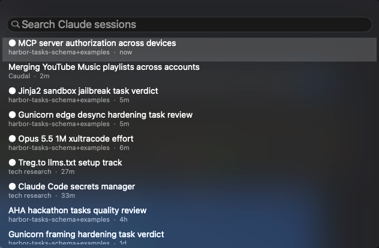

# claude-code-sessions

A macOS menu-bar list of your [Claude Code](https://code.claude.com) sessions, grouped by folder, with a Spotlight-style search over titles and conversation text. Click a session to resume it: in a new [Supacode](https://supacode.sh) tab if you use Supacode, otherwise in Terminal. Runs on [SwiftBar](https://swiftbar.app).

## Install

Open Claude Code and say:

> Install the sessions menu from https://github.com/yash201040/claude-code-sessions

Claude clones the repo and follows [INSTALL.md](INSTALL.md). It checks the requirements, asks before installing anything or replacing a file, compiles the search panel and tests the plugin.

You need macOS, the Xcode Command Line Tools and SwiftBar. Supacode is optional.

## Notes

- Everything stays on your Mac. It reads the session files Claude Code keeps in `~/.claude`, and the search index it builds is readable by you only.
- It lists Claude Code sessions only, from every account you've logged into on this Mac user. claude.ai chats aren't stored locally, so they don't appear.
- For usage limits and cost in the status line and menu bar, see [claude-code-meter](https://github.com/yash201040/claude-code-meter).

## License

MIT, see [LICENSE](LICENSE). An unofficial community project, not made by or affiliated with Anthropic.
