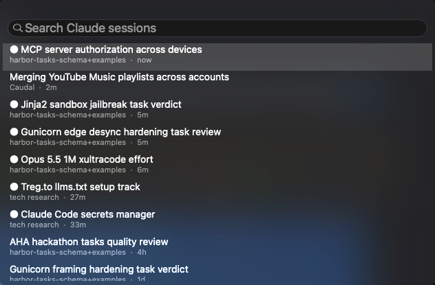

# claude-code-sessions

A macOS menu-bar list of your [Claude Code](https://code.claude.com) sessions, grouped by folder, with a Spotlight-style search over titles and conversation text. Click a session to resume it: in a new [Supacode](https://supacode.sh) tab if you use Supacode, otherwise in Terminal. Runs on [SwiftBar](https://swiftbar.app).

## Install

Open Claude Code and say:

> Install the sessions menu from https://github.com/yash201040/claude-code-sessions

Claude clones the repo and follows [INSTALL.md](INSTALL.md). It checks the requirements, asks before installing anything or replacing a file, compiles the search panel and tests the plugin.

You need macOS, the Xcode Command Line Tools and SwiftBar. Supacode is optional.

## Notes

- Everything stays on your Mac. It reads the session files Claude Code keeps in `~/.claude`, and the search index it builds is readable by you only.
- **Pick the permission mode sessions launch in.** A switch near the top of the menu, **Auto mode** or **Bypass permissions**, decides how every session you open from the menu or the search panel starts (`claude --resume <id> --permission-mode auto` or `bypassPermissions`). A session that is already running keeps its mode. The choice is kept in `~/.local/state/claude-code-sessions/launch-mode`.
- **Sessions agents started are kept apart.** Headless `claude -p` runs and sessions opened in a system temp folder or a crucible run folder are grouped under **Indirects** at the bottom, so the folders you work in stay uncluttered.
- The top of the menu shows the Claude account Claude Code is signed in to, with its plan; hover it for the email. It reads this from Claude Code's own config and makes no network calls.
- It lists Claude Code sessions only, from every account you've logged into on this Mac user. claude.ai chats aren't stored locally, so they don't appear.
- **Renamed folders stay findable.** If you rename a project folder or one of its parents in Finder, the menu follows it, lists its sessions under the new name and resumes them there. Claude Code itself loses track: its resume picker, `--continue` and project memory look under the new name and find nothing. One click on **Move sessions to the new folder name** refiles them so Claude Code finds them again.
- For usage limits and cost in the status line and menu bar, see [claude-code-meter](https://github.com/yash201040/claude-code-meter).

## License

MIT, see [LICENSE](LICENSE). An unofficial community project, not made by or affiliated with Anthropic.
